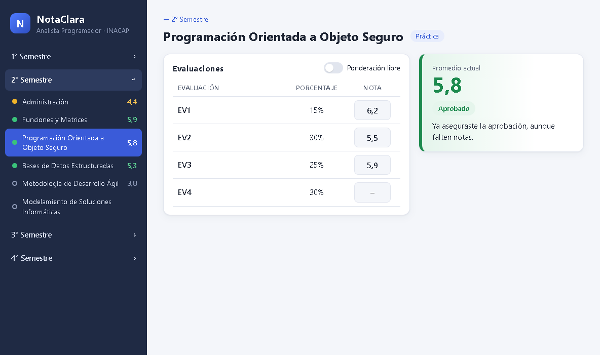
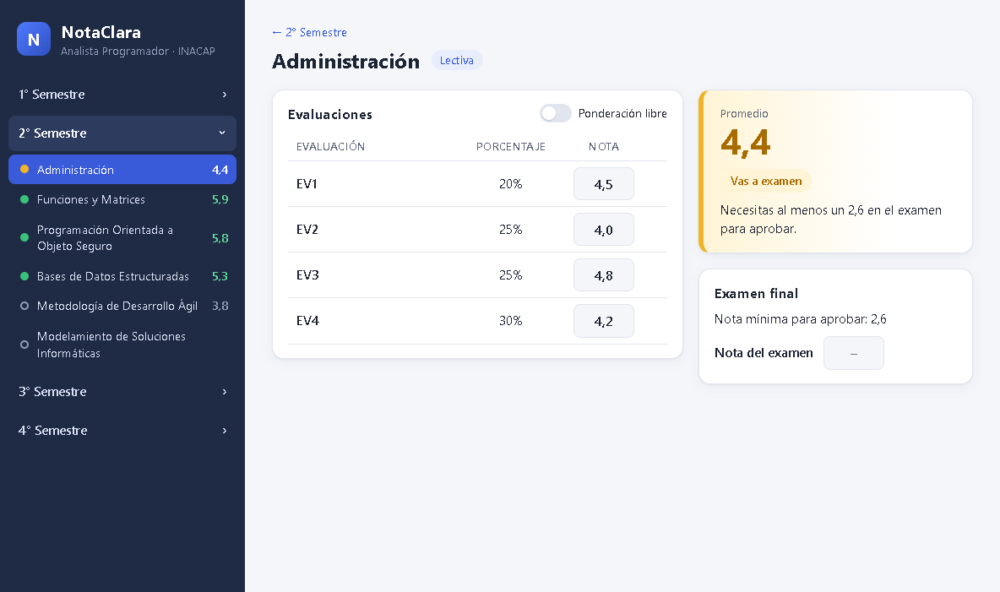

<div align="center">


# NotaClara

**Tu calculadora de notas para Analista Programador · INACAP**

Escribe tus notas y NotaClara te dice al tiro cómo vas, si te eximes<br />
y cuánto necesitas para aprobar. Sin fórmulas, sin internet, sin complicaciones.

<a href="https://github.com/sjmonn7/Notaclara/releases/latest/download/NotaClara-Instalador.exe"></a>

<a href="DESCARGA.md"></a>


<br />
<br />

<picture>
  <source media="(prefers-color-scheme: dark)" srcset="recursos/capturas/principal-oscuro.png" />
  
</picture>

</div>

<br />

## ✨ Qué hace por ti

<table>
<tr>
<td width="50%" valign="top">

### 📚 La malla completa, lista

Los **4 semestres** de Analista Programador vienen cargados, con cada asignatura, su tipo (Práctica o Lectiva) y los porcentajes oficiales de cada evaluación.

</td>
<td width="50%" valign="top">

### 💾 Se guarda solo

Escribe una nota y listo: **no hay botón "Guardar"**. Al cerrar y volver a abrir, tus notas siguen ahí.

</td>
</tr>
<tr>
<td valign="top">

### 🎯 Cuánto te falta

Te dice en una frase la nota mínima que necesitas: *"Para eximirte necesitas un 6,1 en EV4."*

</td>
<td valign="top">

### 🔌 Sin internet

Funciona **100 % sin conexión**. Tus notas se quedan en tu computador y no se envían a ninguna parte.

</td>
</tr>
<tr>
<td valign="top">

### 📝 Examen y faltas justificadas

En las lectivas calcula la **nota mínima del examen** y permite justificar la falta a **una** prueba.

</td>
<td valign="top">

### ⚙️ Ponderación libre

¿Cambiaron los porcentajes durante el semestre? Edita nombres y porcentajes, agrega o quita evaluaciones, y vuelve a la ponderación original cuando quieras.

</td>
</tr>
</table>

### Los colores te dicen cómo vas

| | Estado | Qué significa |
|:---:|---|---|
| 🟢 | **Aprobado / Eximido** | ¡Lo lograste! O ya lo tienes asegurado aunque falten notas. |
| 🟡 | **Vas a examen** | No alcanzaste el 5,0 para eximirte (solo lectivas). Te dice la nota mínima del examen. |
| 🔴 | **Reprobado** | El promedio final no llega a 4,0, o ni con 7,0 en lo que falta alcanzarías. |
| 🟣 | **Falta justificada** | Justificaste la falta a una prueba y falta la nota del examen (solo lectivas). |
| ⚪ | **En curso / Sin notas** | Todavía faltan notas para saber el resultado. |

<div align="center">
<picture>
  <source media="(prefers-color-scheme: dark)" srcset="recursos/capturas/examen-oscuro.png" />
  
</picture>
<br />
<sub>Una asignatura lectiva que va a examen: NotaClara calcula la nota mínima que necesitas.</sub>
</div>

## 🚀 Empieza en 3 pasos

1. **Descarga** el instalador con el botón azul de arriba.
2. **Instálalo** con doble clic. Si Windows muestra *"Windows protegió su PC"*, haz clic en **Más información → Ejecutar de todas formas** (aparece porque el programa no tiene una firma digital pagada).
3. **Ábrelo** desde el ícono del Escritorio, elige tu semestre y una asignatura, y escribe tus notas.

¿Dudas? La **[guía de instalación](DESCARGA.md)** lo explica con más detalle, incluidos los avisos del navegador y qué hacer si algo falla.

## ❓ Preguntas frecuentes

<details>
<summary><b>¿Necesito instalar algo más, como Python o una base de datos?</b></summary>
<br />

No. El instalador trae todo lo necesario. Solo necesitas Windows 10 u 11.
</details>

<details>
<summary><b>¿Cómo escribo las notas?</b></summary>
<br />

De 1,0 a 7,0, con un solo decimal. Puedes usar coma o punto: `5,5` y `5.5` valen lo mismo.
</details>

<details>
<summary><b>¿Cómo redondea?</b></summary>
<br />

Con el redondeo chileno: primero a dos decimales y luego a uno. Por ejemplo, un 4,945 queda en 4,95 y se muestra como **5,0**.
</details>

<details>
<summary><b>¿Se borran mis notas si actualizo o desinstalo?</b></summary>
<br />

No. Tus notas se guardan aparte, en `%APPDATA%\NotaClara\notaclara.sqlite`. Puedes instalar una versión nueva encima sin perder nada. La [guía de instalación](DESCARGA.md#dónde-quedan-guardadas-tus-notas) explica cómo hacer una copia de seguridad.
</details>

<details>
<summary><b>¿Es seguro el aviso "Windows protegió su PC"?</b></summary>
<br />

Windows avisa con todos los programas que no tienen un certificado de firma, que es pagado. NotaClara es un proyecto de estudiantes y no lo tiene. Descárgala solo desde este repositorio.
</details>

<br />

<div align="center">

Hecho con 💙 por **Simon Macías, Fabián Rojas, Natalia Sandoval y Berhane Castro**<br />
<sub>Estudiantes de Analista Programador · INACAP Sede Temuco</sub>

</div>

---

## 🛠️ Para desarrolladores

NotaClara es una aplicación de escritorio hecha con **Electron** (HTML + CSS + JavaScript) que guarda las notas en un archivo **SQLite** local mediante `better-sqlite3`. La interfaz no muestra términos técnicos, fórmulas ni umbrales internos: esos detalles están en las secciones de abajo. Para publicar una versión nueva, sigue [PUBLICAR.md](PUBLICAR.md).

<details>
<summary><b>▶️ Ejecutarla desde VS Code</b></summary>

Requisito para desarrollar: [Node.js](https://nodejs.org/) 22.12 o superior (se probó con Node 24).

1. Abrir la carpeta del proyecto en VS Code.
2. Abrir una terminal (`Terminal → New Terminal`) y ejecutar:

```bash
npm install
npm start
```

`npm install` descarga Electron, electron-builder y better-sqlite3. La primera vez que se ejecuta `npm start`, Electron descarga su programa (una sola vez).

También se puede usar `Run and Debug → Abrir NotaClara` (configurado en [.vscode/launch.json](.vscode/launch.json)).

> `npm start` usa [scripts/iniciar.js](scripts/iniciar.js), que quita la variable `ELECTRON_RUN_AS_NODE` antes de abrir Electron. VS Code a veces la hereda a sus terminales y tareas, y con ella la ventana no se abre.

### Pruebas

```bash
npm test
```

Usa el ejecutor de pruebas que trae Node (`node:test`). Las pruebas están en [test/](test/): cálculos, redondeo, validación de notas y guardado en un archivo SQLite temporal.

</details>

<details>
<summary><b>📦 Generar el instalador (.exe)</b></summary>

```bash
npm run build
```

Crea `dist/NotaClara-Instalador.exe` con electron-builder (instalador NSIS para Windows x64). El nombre no lleva la versión para que el enlace `releases/latest/download/NotaClara-Instalador.exe` sirva siempre; la versión está en `package.json`. El instalador incluye todo lo necesario (Electron y SQLite), así que **quien instala la app no necesita instalar nada más** ni tener internet. Permite elegir la carpeta de instalación y crea accesos directos en el escritorio y en el menú Inicio.

Para generar el instalador sí se necesita internet la primera vez, porque electron-builder descarga sus herramientas. La carpeta `dist/` no se sube al repositorio.

El instalador no está firmado digitalmente, así que Windows SmartScreen puede mostrar un aviso la primera vez ("Más información → Ejecutar de todas formas").

`npm run build` nunca publica nada (`--publish never`). Para subir una versión nueva a GitHub Releases, sigue [PUBLICAR.md](PUBLICAR.md).

> `npm start` usa el mismo archivo de notas que la app instalada. Para probar sin tocar tus notas: `.\dist\win-unpacked\NotaClara.exe --user-data-dir="$env:TEMP\notaclara-prueba"`.

</details>

<details>
<summary><b>🗄️ Dónde se guardan las notas</b></summary>

En un archivo SQLite llamado `notaclara.sqlite`, dentro de la carpeta de datos del usuario de Windows (`app.getPath('userData')`):

```
%APPDATA%\NotaClara\notaclara.sqlite
```

(por ejemplo `C:\Users\<usuario>\AppData\Roaming\NotaClara\notaclara.sqlite`). Nunca se guarda junto al `.exe`, así que desinstalar o actualizar la app no borra las notas. El archivo se crea solo la primera vez que se abre la app, con todas las asignaturas precargadas. Para empezar de cero basta con cerrar la app y borrar ese archivo.

### Tablas

| Tabla | Contenido |
|---|---|
| `semestre` | Los 4 semestres (`numero`, `nombre`) |
| `asignatura` | `nombre`, `semestre_id`, `tipo` (`practica` / `lectiva`), `ponderacion_libre`, `siempre_libre` (electivos), `orden` |
| `evaluacion` | `asignatura_id`, `nombre`, `porcentaje` (entero), `nota` (en décimas: 4,5 se guarda como 45; vacía si está pendiente), `inasistencia_justificada` (0 / 1), `orden` |
| `estado_examen` | `asignatura_id`, `nota_examen` (en décimas) |

Las ponderaciones originales están en [src/datos/malla.js](src/datos/malla.js); se usan para precargar y para "Restaurar ponderación original".

Al abrir una base anterior, la aplicación agrega la nueva marca por evaluación sin borrar las notas guardadas. La antigua marca de falta al examen queda sin uso y no afecta los cálculos.

</details>

<details>
<summary><b>🧮 Reglas de cálculo</b></summary>

Toda la lógica está en [src/logica/calculos.js](src/logica/calculos.js), un módulo sin dependencias de la interfaz ni de la base de datos. La interfaz solo recibe resultados ya redondeados.

### Precisión: solo enteros

No se usan decimales flotantes para comparar. Una nota se maneja en décimas (4,5 → 45) y un porcentaje como entero (30 % → 30). Su producto queda en milésimas: 45 × 30 = 1350 = 1,350. Si los porcentajes suman 100, la suma de los aportes es el promedio ponderado **exacto** en milésimas.

### Redondeo chileno

Primero a 2 decimales (mitad hacia arriba) y luego a 1 decimal (mitad hacia arriba):

| Promedio real | A 2 decimales | Se muestra |
|---|---|---|
| 4,945 | 4,95 | 5,0 |
| 3,945 | 3,95 | 4,0 |
| 4,944 | 4,94 | 4,9 |

La app muestra siempre el valor redondeado, sin avisar nada (si el promedio real es 4,945, se ve 5,0 en verde).

### Umbrales internos (nunca se muestran en la app)

| Umbral | Valor | Equivale a |
|---|---|---|
| Aprobar | **3,945** | 4,0 final |
| Eximirse (solo lectivas) | **4,945** | 5,0 final |

### Asignatura práctica

- Promedio ≥ 3,945 → verde "Aprobado". Si no → rojo "Reprobado". No hay examen.
- Con evaluaciones pendientes se calcula la nota mínima en lo pendiente para llegar a 3,945: `(3,945 − acumulado) ÷ porcentaje pendiente`, redondeada hacia arriba a 1 decimal y como mínimo 1,0.
  - Si es mayor que 7,0 → rojo "Reprobado" aunque falten notas.
  - Si basta con 1,0 → verde "Aprobado" (ya está asegurado).

### Asignatura lectiva

- Promedio de presentación ≥ 4,945 → verde "Eximido".
- Si no → amarillo "Vas a examen" (siempre puede ir a examen, aunque tenga 1,0).
- Nota final con examen = presentación (redondeada) × 0,75 + examen × 0,25. Aprueba si la nota final ≥ 3,945.
- Nota mínima de examen = `(3,945 − presentación × 0,75) ÷ 0,25`, redondeada hacia arriba a 1 decimal, mínimo 1,0. Si es mayor que 7,0 → rojo "Reprobado".
  - Ejemplo: presentación 4,5 → (3,945 − 3,375) ÷ 0,25 = 2,28 → **2,3**. Con 2,3 la final es 3,95 (se ve 4,0, aprueba); con 2,2 es 3,925 (se ve 3,9, reprueba).
- Con evaluaciones pendientes se muestra la nota mínima en lo pendiente para eximirse. Si eximirse ya es imposible → amarillo "Vas a examen". Si ni con 7,0 en todo lo pendiente y 7,0 en el examen alcanza → rojo "Reprobado".

### Falta justificada a una prueba

- El botón "Justificar falta a prueba" aparece solo en asignaturas lectivas, cuando todas las evaluaciones tienen nota, esa evaluación tiene exactamente 1,0 y la nota acumulada sin redondear es menor que 4,945 (va a examen). En prácticas no aparece y el 1,0 queda tal cual.
- Solo se puede justificar **una** prueba por asignatura.
- El 1,0 no se borra de la base de datos (sigue guardado como 10); el reemplazo se hace al calcular. Quitar la justificación deja todo como estaba.
- Sin nota de examen: estado morado "Falta justificada", con la casilla del examen habilitada.
- Con nota de examen E:
  - Presentación = promedio ponderado usando E en lugar del 1,0, con redondeo chileno.
  - Nota final = presentación × 0,75 + E × 0,25. No hay eximición aunque la presentación nueva llegue a 4,945, porque el examen ya se rindió.
  - Ejemplo: 1,0 (30 %, justificada), 4,0 (30 %), 5,0 (40 %) y examen 6,0 → presentación 5,0 → final 5,25 → **5,3**.
  - La casilla de la prueba muestra E y queda bloqueada, igual que "Quitar justificación". Para cambiarla hay que borrar primero la nota del examen.
  - Si después se borra otra nota, el examen deja de usarse mientras falte esa nota: la casilla vuelve a mostrar el 1,0 y se desbloquea. Al completar la nota, vuelve a usarse el examen.
- Nota mínima de examen: como el examen cuenta dos veces, se prueba cada nota de 1,0 a 7,0 y se muestra la primera que aprueba. Si ninguna alcanza → rojo "Reprobado".
- Si después otras notas suben la acumulada (con el 1,0) a 4,945 o más, la justificación se quita sola.
- Al ingresar una nota inválida, el promedio y la nota final se ocultan hasta corregirla. La nota inválida no se guarda ni se usa en los cálculos.

### Validación de notas

- Los campos de nota y examen solo permiten números entre 1,0 y 7,0, con hasta un decimal; se acepta coma o punto (`6,3` y `6.3`) y se muestran siempre con coma y un decimal.
- También se aceptan dos dígitos sin separador: `55` se lee como 5,5. Valores como `71` (7,1) o `80` son inválidos.
- Fuera de 1,0 a 7,0 → "Nota inválida. Ingrese una nota entre 1,0 y 7,0."
- Más de un decimal (`6,34`) → "Nota inválida. Ingrese un número con UN solo decimal."
- En ponderación libre, los campos de porcentaje solo permiten números enteros de 0 a 100. Si no suman 100 % no se calcula el estado y se muestra "Los porcentajes deben sumar 100%."
- Dos evaluaciones de la misma asignatura no pueden tener el mismo nombre (sin importar mayúsculas), porque al restaurar la ponderación original las notas se conservan por nombre.

</details>

<details>
<summary><b>📁 Estructura de carpetas</b></summary>

```
NotaClara/
├── package.json             Dependencias, scripts (start, test, build) y configuración del instalador
├── DESCARGA.md              Guía de descarga e instalación para usuarios
├── PUBLICAR.md              Cómo generar y publicar una versión nueva
├── REVISION-ERRORES.md      Errores encontrados y corregidos en la revisión de noviembre de 2026
├── recursos/
│   ├── icono.png            Ícono de la app y del instalador
│   └── capturas/            Capturas de pantalla del README (claro y oscuro); no van en el instalador
├── scripts/
│   └── iniciar.js           Abre Electron para `npm start`
├── src/
│   ├── datos/
│   │   └── malla.js         Semestres, asignaturas y ponderaciones originales
│   ├── logica/
│   │   └── calculos.js      Cálculos puros: redondeo, umbrales, estados, validación
│   ├── main/
│   │   ├── main.js          Proceso principal de Electron (ventana y comunicación con la interfaz)
│   │   ├── preload.js       Puente seguro entre la interfaz y el proceso principal
│   │   ├── basedatos.js     Archivo SQLite: tablas, precarga y consultas
│   │   └── servicio.js      Une datos y cálculos; entrega todo listo para mostrar
│   └── renderer/
│       ├── index.html       Interfaz
│       ├── estilos.css
│       └── app.js           Comportamiento de la interfaz (no calcula nada)
└── test/
    ├── calculos.test.js     Pruebas de la lógica (incluye las migradas de test_calculos.py)
    └── servicio.test.js     Pruebas de guardado y ponderación libre
```

</details>

<details>
<summary><b>📜 Historia</b></summary>

La primera versión era una aplicación de terminal en Python con MySQL (peewee + pymysql) y luego tuvo una interfaz con customtkinter. Esta versión la reemplaza por completo: ya no se necesita Python, MySQL, WAMP/XAMPP ni el archivo `.env`.

</details>
